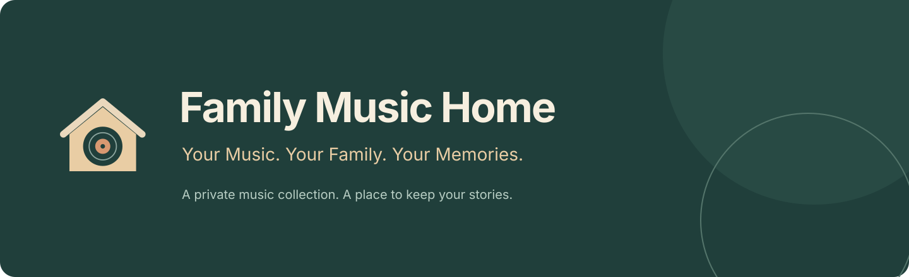
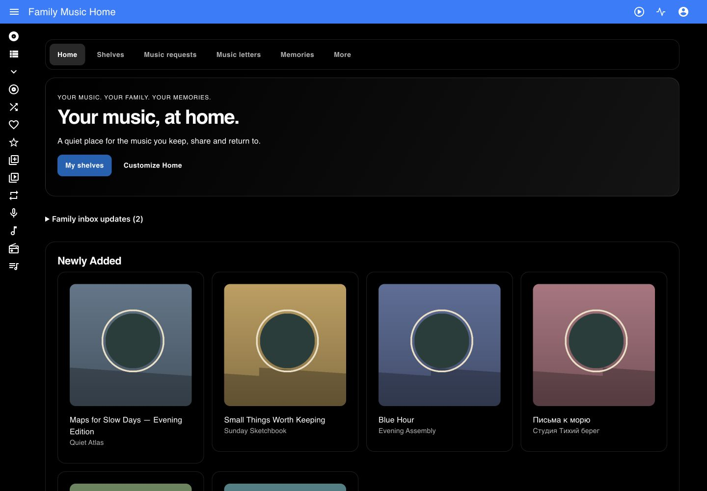

# Family Music Home

**Your Music. Your Family. Your Memories.**

[English](README.md) · [Русский](README.ru.md)

A home music server for personal libraries, shelves, letters and memories. Free GPLv3 software and an unofficial fork of [Navidrome](https://github.com/navidrome/navidrome).



[Real application gallery](docs/en/gallery.md) · [Feature inventory](docs/en/feature-matrix.md)

## Why Family Music Home

Listen to your own music in the browser and compatible OpenSubsonic clients. Share selected shelves and memories while keeping separate accounts and library permissions. Start with a folder on your computer; connect remote collections when you need them.

No premium modules, advertising or required donations. You pay for your own optional hosting and storage. There is no shared online demo server.

## Music and family features

Library browsing, artists, albums, genres, search, queue, playlists, favourites, ratings, transcoding and OpenSubsonic come from Navidrome. [Browse music](docs/en/library.md) · [Player and playlists](docs/en/player.md).

| Module | Guide |
|---|---|
| Family Home | [Read](docs/en/features/home.md) |
| Family Shelves | [Read](docs/en/features/shelves.md) |
| Time Capsule | [Read](docs/en/features/capsules.md) |
| Music Letters | [Read](docs/en/features/letters.md) |
| Music Requests | [Read](docs/en/features/requests.md) |
| Forgotten Albums | [Read](docs/en/features/forgotten.md) |
| Quality Passport | [Read](docs/en/features/passport.md) |
| Library Doctor | [Read](docs/en/features/doctor.md) |
| Version Collector | [Read](docs/en/features/versions.md) |
| Kids Music World | [Read](docs/en/features/kids.md) |
| Legacy Export | [Read](docs/en/features/legacy.md) |

## Storage, plugins and themes

[Local Docker](docs/en/deploy/docker.md) · [Bunny](docs/en/integrations/bunny.md) · [S3](docs/en/integrations/s3.md) · [SFTP](docs/en/integrations/sftp.md) · [HTTPS WebDAV](docs/en/integrations/webdav.md) · [NAS](docs/en/integrations/nas.md)

Music is read from approved libraries. Removing a connection does not delete originals. [Mac Family Sync](docs/en/integrations/mac-sync.md) works only Mac → Bunny and never deletes remote objects.

[Lyrics](docs/en/plugins/lyrics.md) · [Apple Music metadata](docs/en/plugins/apple-music.md) · [Cover Art Archive](docs/en/plugins/cover-art.md) · [27 themes](docs/en/themes.md)

## Quick Start

Install Docker Desktop. Download the source, set your own music folder in `.env`, and build locally:

```sh
cp .env.example .env
# Set FMH_MUSIC_DIR to an existing absolute music-folder path in .env
docker compose -f compose.family.yml up -d --build
```

Open `http://localhost:4533`. To create the first account securely, read your own instance’s setup token:

```sh
docker compose -f compose.family.yml exec music cat /data/setup-token
```

Choose your own administrator username and a password of at least 12 characters. Keep the token private. The step-by-step [guide](docs/en/quickstart.md) explains folders, permissions and your first track. The first build takes several minutes.

## Guides and compatibility

[Documentation](docs/en/index.md) · [Local demo](docs/en/local-demo.md) · [Bunny Magic Containers](docs/en/deploy/bunny.md) · [Backups](docs/en/backups.md) · [Updates](docs/en/updating.md)

The release profile targets Linux/amd64 in Docker Desktop. Codecs depend on the browser; FFmpeg transcoding supports other playback needs. Browser emulation does not establish physical NAS or phone acceptance. Consult the acceptance matrix for exact coverage.

## License and provenance

GNU GPL version 3: [LICENSE](LICENSE), [NOTICE](NOTICE.md), [third-party components](THIRD_PARTY_NOTICES.md), [upstream differences](UPSTREAM_DIFFERENCES.md). Original Navidrome copyright and authorship are preserved. This is not an official Navidrome release.

## Who made this?

Made by [@vbrekher](https://github.com/vbrekher). A special thank-you to my beloved wife [@krisbrekher](https://github.com/krisbrekher) for her ideas and inspiration. ❤️

## Support development

**Support Family Music Home:** contribute code, translations, documentation and reproducible reports. No verified project donation destination has been supplied yet.

**Support Navidrome:** see support options in the [official project](https://github.com/navidrome/navidrome#sponsors). Support is voluntary and unlocks no extra features.
