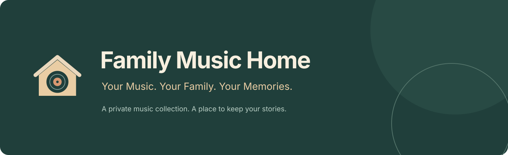
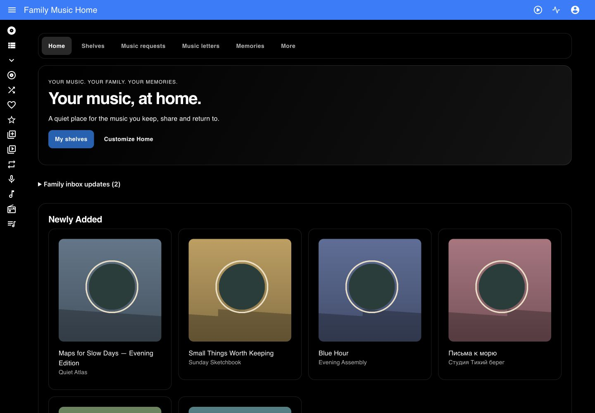

# Family Music Home

**Your Music. Your Family. Your Memories.**

[English](README.md) · [Русский](README.ru.md)

Домашний музыкальный сервер с персональными библиотеками, полками, письмами и воспоминаниями. Бесплатное свободное ПО GPLv3. Неофициальный форк [Navidrome](https://github.com/navidrome/navidrome).



[Галерея приложения](docs/ru/gallery.md) · [Матрица функций](docs/ru/feature-matrix.md)

## Почему Family Music Home

Слушайте свою музыку в браузере и совместимых OpenSubsonic-клиентах. Делитесь выбранными полками и воспоминаниями, сохраняя отдельные аккаунты и права на библиотеки. Начните с папки на компьютере; подключайте удалённые коллекции по необходимости.

Нет Premium-модулей, рекламы и обязательных пожертвований. Пользователи самостоятельно оплачивают свой необязательный хостинг и storage. Общего онлайн-демосервера нет.

## Музыка и семейные функции

Библиотека, исполнители, альбомы, жанры, поиск, очередь, плейлисты, избранное, рейтинги, транскодирование и OpenSubsonic унаследованы от Navidrome. [Просмотр музыки](docs/ru/library.md) · [Плеер и плейлисты](docs/ru/player.md).

| Модуль | Руководство |
|---|---|
| Семейная главная | [Открыть](docs/ru/features/home.md) |
| Музыкальные полки | [Открыть](docs/ru/features/shelves.md) |
| Капсула воспоминаний | [Открыть](docs/ru/features/capsules.md) |
| Музыкальные письма | [Открыть](docs/ru/features/letters.md) |
| Запросы музыки | [Открыть](docs/ru/features/requests.md) |
| Забытые альбомы | [Открыть](docs/ru/features/forgotten.md) |
| Паспорт качества | [Открыть](docs/ru/features/passport.md) |
| Проверка библиотеки | [Открыть](docs/ru/features/doctor.md) |
| Коллекция изданий | [Открыть](docs/ru/features/versions.md) |
| Детский музыкальный мир | [Открыть](docs/ru/features/kids.md) |
| Архив истории | [Открыть](docs/ru/features/legacy.md) |

## Хранилища, плагины и темы

[Local Docker](docs/ru/deploy/docker.md) · [Bunny](docs/ru/integrations/bunny.md) · [S3](docs/ru/integrations/s3.md) · [SFTP](docs/ru/integrations/sftp.md) · [HTTPS WebDAV](docs/ru/integrations/webdav.md) · [NAS](docs/ru/integrations/nas.md)

Музыка читается из разрешённых библиотек. Удаление конфигурации подключения не удаляет оригиналы. [Mac Family Sync](docs/ru/integrations/mac-sync.md) работает только Mac → Bunny и не удаляет удалённые объекты.

[Lyrics](docs/ru/plugins/lyrics.md) · [Apple Music metadata](docs/ru/plugins/apple-music.md) · [Cover Art Archive](docs/ru/plugins/cover-art.md) · [27 тем](docs/ru/themes.md)

## Быстрый старт

Нужен Docker Desktop. Скачайте исходники, укажите собственную папку музыки в `.env` и соберите локально:

```sh
cp .env.example .env
# Set FMH_MUSIC_DIR to an existing absolute music-folder path in .env
docker compose -f compose.family.yml up -d --build
```

Откройте `http://localhost:4533`. Для безопасного первого аккаунта прочитайте setup-token именно своего экземпляра:

```sh
docker compose -f compose.family.yml exec music cat /data/setup-token
```

Создайте администратора с собственным логином и паролем от 12 символов. Не публикуйте токен. Полное пошаговое [руководство](docs/ru/quickstart.md) объясняет папки, права и первый трек. Первая сборка занимает несколько минут.

## Руководства и совместимость

[Документация](docs/ru/index.md) · [Локальное демо](docs/ru/local-demo.md) · [Bunny Magic Containers](docs/ru/deploy/bunny.md) · [Копии](docs/ru/backups.md) · [Обновление](docs/ru/updating.md)

Релизный профиль ориентирован на Linux/amd64 в Docker Desktop. Кодеки зависят от браузера; для других форматов доступно FFmpeg-транскодирование. Физические NAS и телефоны не считаются проверенными по результатам браузерной эмуляции. Подробные статусы публикуются в матрице приёмки.

## Лицензия и происхождение

GNU GPL version 3: [LICENSE](LICENSE), [NOTICE](NOTICE.md), [сторонние компоненты](THIRD_PARTY_NOTICES.md), [отличия upstream](UPSTREAM_DIFFERENCES.ru.md). Copyright и авторство исходного Navidrome сохранены. Это не официальный релиз Navidrome.

## Кто создал проект

Автор — [@vbrekher](https://github.com/vbrekher). За идеи и вдохновение спасибо моей любимой жене [@krisbrekher](https://github.com/krisbrekher). ❤️

## Поддержка разработки

**Support Family Music Home:** помогайте кодом, переводами, документацией и воспроизводимыми отчётами. Подтверждённая платёжная ссылка пока не предоставлена.

**Support Navidrome:** способы поддержки указаны в [официальном проекте](https://github.com/navidrome/navidrome#sponsors). Поддержка добровольная и не открывает дополнительных функций.
